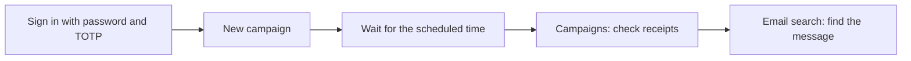
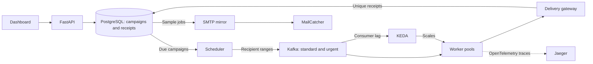
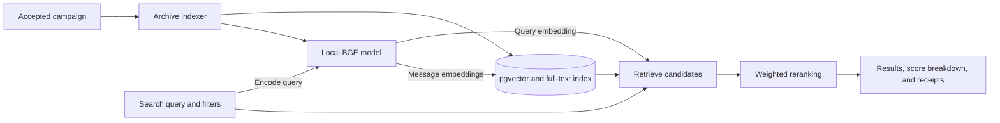

# EmailFlow

Schedule synthetic email campaigns, verify delivery and recovery, and search accepted messages by keyword or meaning. The local stack uses Kind, Kafka, PostgreSQL with pgvector, and MailCatcher.

## Run locally

From the repository root, use Bash with Docker Desktop in Linux mode, Kind 0.24+, kubectl, Helm, and Python 3.12. On Windows, use WSL2 with Docker integration. Allow 8–12 GB of Docker memory and free disk for images and the model.

```bash
bash scripts/start-local.sh
bash scripts/users.sh create admin --role admin  # First run only
```

Set a password of at least 15 characters and enroll the printed TOTP secret in an authenticator. In a second terminal, run `bash scripts/ports.sh` and keep it open.

| Local service | Use it to |
| --- | --- |
| [Dashboard](http://localhost:8080) | Sign in, schedule campaigns, and search the archive |
| [MailCatcher](http://localhost:1080) | Inspect sampled messages |
| [Jaeger](http://localhost:16686) | Trace a delivery or failure |

See the [operations guide](docs/OPERATIONS.md) for an existing v1 installation, custom ports, or a separate test cluster.

## Use the dashboard



1. In **New campaign**, enter a subject such as `Invoice payment reminder`, a short body, **20** recipients, and a time about a minute ahead. Choose **Standard** and request **2** MailCatcher samples.
2. In **Campaigns**, open the campaign. Before the scheduled time, accepted stays at zero. After delivery, look for **20 accepted**, **20 completed**, and 20 unique receipts. Open MailCatcher to check the two samples.
3. In **Email search**, wait for indexing, then search for `invoice payment`. Filter by priority, date, or recipient number. Open a result to see the message and receipts. Adjust the weights to compare how results rank.

Viewers can read and search. Operators can also schedule and cancel before dispatch. Admins can also run crash simulations and open **Observability** and **Security**.

## Test it

### In the dashboard

| Test | What to check |
| --- | --- |
| Schedule the 20-recipient campaign above | Zero early acceptance, 20 unique receipts, and two MailCatcher samples |
| **Simulation lab → Gateway crashes after accept** | In **Observability**, the incident recovers and the receipt count matches the campaign size |
| **Simulation lab → Worker crashes after ACK** | The replay completes and the receipt and completion counts match the campaign size |
| **Email search** | Schedule a second, urgent campaign with a different subject. Compare keyword-only and urgency-only ranking, then filter by recipient number |
| **Simulation lab → Urgent burst** | On a resource-appropriate cluster, watch Kafka lag and desired and ready worker replicas in **Observability** |

### From the terminal

Use Node.js 22 and npm for the frontend build.

```bash
python3 -m venv .venv
source .venv/bin/activate
python -m pip install -r backend/requirements.txt
python -m unittest discover -s tests -v
(cd frontend && npm ci && npm run build)

# With the dashboard and port forwards running
python scripts/verify-local.py
```

The integration script prompts for admin credentials and checks scheduling, exact receipt counts, both crash paths, and archive ranking. Use a dedicated `-test` cluster for `--ephemeral-users --embedding-outage`. Use `--million` only with capacity for one million recipients **per worker pool**.

```bash
KUBECONFIG="${KUBECONFIG:-$PWD/.emailflow-kubeconfig}" \
  kubectl --context kind-emailflow -n emailflow get pods,hpa,scaledobject
```

## How it works



One campaign stores one schedule. At 100 recipients per task, one million recipients produce 10,000 Kafka tasks. The gateway records each receipt once, and workers commit offsets after recording completion. KEDA can scale the standard pool to 12 workers and the urgent pool to 24.



Default ranking weights are **60% semantic**, **25% keyword**, **10% recency**, and **5% urgency**. Search uses the remaining enabled weights during an embedding outage.

## Operations and validation

The recorded v2 run passed **22 tests**, the frontend build, and isolated API, pgvector, and BGE checks. Full Kind v2 verification, scale-out, image scanning, and ZAP remain open. See [verification results](docs/OPERATIONS.md#recorded-verification), [security scans](docs/OPERATIONS.md#security-scanning-and-release-requirements), and the [contributor standards](docs/DEVELOPMENT.md).
