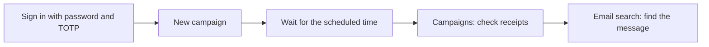
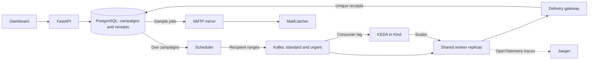
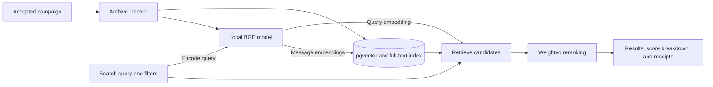

# EmailFlow

Schedule synthetic email campaigns, verify delivery and recovery, and search accepted messages by keyword or meaning. The local stack uses Docker Compose, Kafka, PostgreSQL with pgvector, and MailCatcher.

## Run locally

From the repository root, use Docker Desktop in Linux mode and Python 3.12. Allow 8–12 GB of Docker memory and free disk for images and the model.

```text
python scripts/compose_local.py
```

Open the dashboard and choose **Create an account**. Enter your email and a password of at least 15 characters, then verify a code from your authenticator app. Compose registrations receive the operator role. Use **Administrator setup** to create an admin for crash simulations and observability.

To seed the optional read-only local demo, run `python scripts/compose_local.py run --rm users seed-demo` and enter a demo password. Then choose **Use demo account** to sign in as `user@example.com`. Docker Desktop groups the containers under **emailflow**.

| Local service | Use it to |
| --- | --- |
| [Dashboard](http://localhost:8080) | Sign in, schedule campaigns, and search the archive |
| [MailCatcher](http://localhost:1080) | Inspect sampled messages |
| [Jaeger](http://localhost:16686) | Trace a delivery or failure |

See the [operations guide](docs/OPERATIONS.md) for Compose commands, v1 data migration, custom ports, or Kind and KEDA testing.

## Use the dashboard



1. In **New campaign**, enter a subject such as `Invoice payment reminder`, a short body, **20** recipients, and a time about a minute ahead. Choose **Standard** and request **2** MailCatcher samples.
2. In **Campaigns**, open the campaign. Before the scheduled time, accepted stays at zero. After delivery, look for **20 accepted**, **20 completed**, and 20 unique receipts. Open MailCatcher to check the two samples.
3. In **Email search**, wait for indexing, then search for `invoice payment`. Filter by priority, date, or recipient number. Open a result to see the message and receipts. Adjust the weights to compare how results rank.

Viewers can read and search. Operators can also schedule and cancel before dispatch. Admins can also run crash simulations and open **Observability** and **Security**.

## Test it

### In the dashboard

| Test | What to check |
| --- | --- |
| Schedule the 20-recipient campaign above | Zero early acceptance, 20 unique receipts, and two MailCatcher samples |
| **Simulation lab → Gateway crashes after accept** | In **Observability**, the incident recovers and the receipt count matches the campaign size |
| **Simulation lab → Worker crashes after ACK** | The replay completes and the receipt and completion counts match the campaign size |
| **Email search** | Schedule a second, urgent campaign with a different subject. Compare keyword-only and urgency-only ranking, then filter by recipient number |
| **Simulation lab → Urgent burst** | Watch Kafka lag in **Observability**. Use Kind to test automatic worker scaling |

### From the terminal

Use Node.js 22 and npm for the frontend build.

```bash
python3 -m venv "$HOME/.venvs/emailflow"
source "$HOME/.venvs/emailflow/bin/activate"
python -m pip install -r backend/requirements.txt
python -m unittest discover -s tests -v
(cd frontend && npm ci && npm run build)

# With the Compose dashboard running
python scripts/verify-local.py --compose
```

The integration script prompts for admin credentials and checks scheduling, exact receipt counts, both crash paths, and archive ranking. Use Kind for `--million` to test KEDA with one million recipients per priority.

```text
python scripts/compose_local.py ps
python scripts/compose_local.py logs --tail 50 worker
python scripts/compose_local.py up -d --scale worker=3
```

## How it works



One campaign stores one schedule. At 100 recipients per task, one million recipients produce 10,000 Kafka tasks. Each worker handles both queues and gives urgent tasks precedence within its fetched batch. Workers commit Kafka offsets after durable completion. Compose starts one replica and scales manually with the command above. KEDA in Kind scales the same deployment from 1 to 24 replicas using combined Kafka lag.



Default ranking weights are **60% semantic**, **25% keyword**, **10% recency**, and **5% urgency**. Search uses the remaining enabled weights during an embedding outage.

## Trade-offs

| Choice | Benefit | Cost |
| --- | --- | --- |
| Campaign ranges in Kafka | One schedule fans out into replayable tasks that workers divide across partitions. | Kafka adds a broker and requires coordination with PostgreSQL. A PostgreSQL queue would be simpler for small workloads. |
| Shared workers with KEDA in Kind | Either queue can use the same worker capacity. Kafka lag drives replica scaling. | The queues share capacity, and urgent tasks take precedence within a fetched batch. Scaling takes time and depends on partition distribution. |
| Idempotent gateway and sampled SMTP | Retries preserve one simulated receipt per recipient. MailCatcher lets you inspect samples. | Each receipt costs a database write. SMTP acceptance can still be uncertain. |
| Local embeddings and pgvector | Hybrid search uses the database and runs without an external model API. | Embedding consumes CPU and memory. Search and delivery share PostgreSQL capacity. |

The default Compose stack has **13 running containers** after the one-time `migrate` job exits. Seven support the delivery workflow (`frontend`, `api`, `postgres`, `kafka`, `scheduler`, `worker`, and `gateway`). The other six support search (`archive`, `embedding`), SMTP samples (`mirror`, `mailcatcher`), and distributed tracing (`otel`, `jaeger`). A delivery-only deployment could omit those feature pairs with configuration changes. The `users` job runs on demand.

## Operations and validation

The recorded v2 run passed **22 tests**, the frontend build, and isolated API, pgvector, and BGE checks. Full Kind v2 verification, scale-out, image scanning, and ZAP remain open. See [verification results](docs/OPERATIONS.md#recorded-verification), [security scans](docs/OPERATIONS.md#security-scanning-and-release-requirements), and the [contributor standards](docs/DEVELOPMENT.md).
